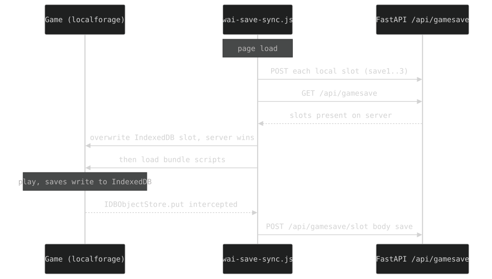

# Nightfall — Architecture

Grid-based hacking tactics RPG in the browser. Single-page React app, no
backend of its own — it rides inside the exec-fn FastAPI container, which
serves the static bundle and provides a tiny save-sync API.

---

## Tech stack

| Layer | Tech | Notes |
|-------|------|-------|
| UI | React 17 (`react-dom`) | Mostly class components on the `PComponent` base (promisified `setState` = `setStateP`): 23 of the 35 `components/*.tsx`. Function/hook components: `SMART`, `GuideText` and the react-three-fiber files (`Netmap3D`, `netmap3d/*`) |
| Language | TypeScript 5.9 | `ts-loader` with `transpileOnly: true` (type-checking is `npm run typecheck`, not part of the build or the hook) |
| 3D | three.js 0.184 + `@react-three/fiber` 7 + `@react-three/drei` 8 | Only for the Netmap3D overworld; battles are DOM/CSS |
| Persistence | `localforage` (IndexedDB) | Save slots; mirrored server-side via `wai-save-sync.js` |
| Bundler | webpack 5 | Custom config, no CRA. `MiniCssExtractPlugin`, `DefinePlugin`, custom `NetmapBakeGuardPlugin` |
| Tests | vitest 4 | `util/battleLogic.test.ts`, `programs/_helpers.test.ts` (`vitest.config.ts` includes `**/*.test.ts`, node environment) |
| Lint | ESLint 9 (`typescript-eslint`, react, react-hooks) + stylelint 16 | Configs in `nightfall-src/` (`eslint.config.js`, `.stylelintrc.json`); `max-lines` 400 and `complexity` 15 are warnings |
| Utilities | `classnames`, `clone`, `csstype` | `clone` does the deep state snapshots (move undo) |

`nightfall-src/serviceWorker.js` is `unregister()`-ed at boot (`index.tsx`) and the root `precache-manifest.*.js` / `asset-manifest.json` are unused CRA build output. Game history (reverts, superseded designs, CRA remnants): [ARCHAEOLOGY.md](ARCHAEOLOGY.md).

---

## Repo layout

```
nightfall/
  nightfall-src/          # all source
    index.tsx             # entry: font preload -> <Loader/>
    index.css, global.d.ts
    components/           # React components (+ per-component CSS)
      netmap3d/           # CameraController, NetmapNode, NetmapEdges, NetmapFloor, RevealContext
    campaign/             # game data: netmap.ts (+ netmap.baked.ts), characters,
                          #   levels/ (49 levels + _defineLevel.ts + __TEMPLATE__.ts),
                          #   dialogues/ (55 + generated index.ts), audio configs, node styles
    programs/             # 59 program definitions (IProgram), index.ts barrel, _helpers.ts
    audio/                # audioSources.ts (URL table over AUDIO_BASE_URL); the .mp3 files
                          #   beside it are not referenced by the build (served copies: root audio/)
    img/                  # program/character/UI images
    types/                # shared interfaces (IProgram, IGameStatus, Coordinate, ...)
    util/                 # battleLogic, AIController, path, AudioContext/Shuffler, parseDialogue
    db/                   # localforage instance + gameStatus load/save
    scripts/              # bakeNetmap.js, genDialogueIndex.js
    bin/                  # recolor_icons.py, image-list.ts
    webpack/bootstrap     # webpack helper
    webpack.config.js
  static/                 # compiled output (gitignored js/css) — building IS deploying
  audio/                  # mp3s served directly
  index.html              # boot progress bar (window.__nfProgress), loads bundle
  wai-head.js             # AudioContext autoplay-unlock patch
  wai-body.html           # fullscreen wrapper (#wai-fs-btn, portrait rotation)
  wai-save-sync.js        # IndexedDB <-> /api/gamesave sync
  scripts/                # pre-commit, install-hooks.sh
  docs/superpowers/specs/ # design specs (netmap 3D)
  graphify-out/           # GENERATED knowledge graph, gitignored, never committed
```

---

## Build and deploy

The repo is volume-mounted into the exec-fn container; FastAPI serves
`static/` straight off disk, so a production webpack build is the deploy.
`NODE_ENV=production` is mandatory — it switches `publicPath`
(`/nightfall-game/static/`, dev `/static/`) and `AUDIO_BASE_URL` to the `/nightfall-game/`
mount; without it assets 404 (silent black screen). `npm run build` sets it
itself, but a bare `webpack` invocation does not.



Two invariants the build enforces:

- **Bake guard** — `netmap.baked.ts` embeds a sha256 of `netmap.ts`;
  webpack refuses to compile if they diverge (`NetmapBakeGuardPlugin`). Re-bake with
  `npm run bake-netmap`.
- **Chunk hashing** — the entry `bundle.js` keeps a stable name (exec-fn appends
  `?v=<mtime>` at serve time, and the save-sync loader adds `v=Date.now()` on top, so the
  entry is refetched every load), but lazy per-level chunks get a
  `[contenthash:8]` so a changed chunk can never serve stale. `static/media/` assets are
  `[contenthash:8]`-named too.

---

## Serving topology



The page route is `/nightfall`; all assets resolve through the injected
`<base href="/nightfall-game/">` against the static mount. The wrapper files
(`wai-head.js`, `wai-body.html`, `wai-save-sync.js`) live in this repo but are injected
by exec-fn at serve time (`build_nightfall_html()`) and are not imported by the build. The
game only touches them softly, by DOM name: `Tutorial.tsx` lets `#wai-fs-btn` through its
input block and `Netmap3D.tsx` reads the `wai-fs-rotated` body class. exec-fn also injects
a service-worker unregister script, the favicon (`hack.png`) and iOS web-app meta tags.
The bundle `<script>` tags are stripped from `index.html` and loaded by the sync script
after the save restore, each as `?v=<mtime>` plus an appended `v=Date.now()`.

---

## Runtime component architecture

Boot: `index.html` paints a progress bar (`window.__nfProgress`),
`index.tsx` preloads the three bitmap fonts, then mounts `Loader`.



`Loader` owns the three save slots, the audio player and the image preload, and mounts
`App` for the selected save. `App` is the single source of truth for game progression
(`IGameStatus`: node statuses, credits, owned programs) and switches `currentUI`
(netmap / battle / warez / SMART / tutorial). Levels are loaded with
`await import("../campaign/levels/" + id)` when a netmap node is **selected**
(`onSelectNode`; warez and SMART nodes import again on enter) — each level becomes its
own webpack chunk, fetched on first selection (the four `warez-*` levels are also
imported statically, by `App` and `uploadEntries.ts`). Only `Netmap3D.tsx` is live; the
old 2D `Netmap.tsx` has been removed (a Claude Code hook still denies recreating it).

---

## Battle engine


Key conventions (see CLAUDE.md for the full list):

- Program actions return arrays of effect promises (`ac.*`), all awaited;
  `targetID` is null on empty cells — effects gate on it.
- Move undo is a per-program full-state snapshot (`undoStates[programId]`) taken the first
  time a still-pristine program is selected in a turn, kept across repeat undos, deleted when
  that program acts, and all cleared at `nextTurn` — never undoable past an attack.
- `buildUploadEntries` is the single source of truth for shop/upload
  ordering (grouped by program line, sorted by warez tier).

---

## Audio

Web Audio API behind `util/AudioContext.ts` (`IAudioContext`), with
`AudioShuffler` cycling per-corp track configs
(`campaign/corpAudioConfigs.ts`, `databattleAudioShuffleConfig.ts`).
Files fetched from `AUDIO_BASE_URL` (webpack DefinePlugin:
`/nightfall-game/audio` in prod, `/audio` in dev). Two autoplay-policy
patches wrap the constructor and resume suspended contexts on
`visibilitychange` (`index.html` and `wai-head.js`/`wai-body.html` — the
wrapper variant tracks `window._waiAudioContexts`).

---

## Saves

Local-first: `db/` wraps a `localforage` IndexedDB instance
(db `nightfall`, store `nightfall-save`; slots `save1`..`save3`); `db/gameStatus.ts`
stores each slot as a JSON **string** (credits, collected credit ids, netmap statuses,
security level, owned program ids, tutorial flag, scroll position, first-clear record,
available nightfall nodes; program ids are re-resolved on load, `Kuang12` -> `Kuang13`).
The exec-fn wrapper (`wai-save-sync.js`) syncs slots so saves roam across devices. On load
it starts uploading every local slot (fire-and-forget, not sequenced against the next
step), GETs `/api/gamesave`, and for every slot the server **has** overwrites the local
IndexedDB value (server wins; no newer-wins merge; a slot the server lacks keeps its local
value), and only then loads the bundle scripts. Every `IDBObjectStore.put` on the store
with a string key is intercepted and POSTed as `{save: <value>}`.



Server slots live behind guest auth (64KB cap per POST); the game itself never talks to the
API — only the injected sync script does. Server-side slot scoping (per-caller
owner/guest buckets) is exec-fn's concern: its ARCHITECTURE.md §20f.

---

## Tooling

| Command (in `nightfall-src/`) | What |
|---|---|
| `NODE_ENV=production npm run build` | webpack → `../static/` (this is the deploy, ~45s) |
| `npm start` | webpack-dev-server on :3000 |
| `npm run bake-netmap` | regenerate `netmap.baked.ts` (required after editing `netmap.ts`) |
| `npm run gen-dialogues` | regenerate `dialogues/index.ts` |
| `npm test` | `vitest run` (`util/battleLogic.test.ts`, `programs/_helpers.test.ts`) |
| `npm run typecheck` | `tsc --noEmit` (~50s; not in the hook, run before pushing type changes) |

Git hooks: this repo's pre-commit is its OWN lint hook (`scripts/pre-commit`, not exec-fn's
sub-repo shim; exec-fn's session hook leaves it alone): it lints staged `.ts/.tsx` (ESLint)
and `.css` (stylelint) — errors block, warnings pass; `bash scripts/install-hooks.sh`
symlinks it into `.git/hooks/` (no `core.hooksPath`). Post-commit/post-checkout graphify hooks are installed but inert (`GRAPHIFY_SKIP_HOOK=1`); `graphify-out/` is regenerated by hand.

`nightfall-src/bin/recolor_icons.py` recolors program icon PNGs — recoloring a program
means updating both its `.ts` `color` and its icon (see CLAUDE.md).

Claude Code guard hooks (exec-fn's `.claude/hooks/` — exec-fn owns every
hook and check — registered in its `.claude/settings.json`, fail-open): `nightfall-build-guard.py` denies a webpack
build without `NODE_ENV=production` or not in the background;
`dead-file-guard.sh` denies recreating `components/Netmap.tsx`.

---

## Hosting contract (what exec-fn provides)

The game assumes, and exec-fn supplies: `GET /nightfall` renders `index.html`
with a `<base href="/nightfall-game/">`, the `wai-*` wrappers and `?v=` on the
bundles; `/nightfall-game/*` is a static mount of this repo; `/api/gamesave/*`
holds per-caller save slots (guest tier, 64KB cap, JSON-string bodies only); `nightfall-src/` is masked by an empty tmpfs inside
the container (nothing at runtime reads source; webpack runs on the host).
All of that lives in exec-fn (`api/routes_nightfall.py`, `gamesave_store.py`,
`docker-compose.yml`); this repo is a git submodule of exec-fn.
